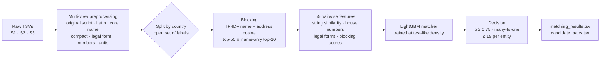

# Amazon Business Entity Resolution

Matching the same business across three messy data sources, at scale, on a laptop-class machine.


Business records are rarely clean. The same company might appear as `राम मार्केटिंग प्राइवेट लिमिटेड` in one file, `Ram Marketing Pvt Ltd` in another, and with a completely different address in a third. This project takes three such sources and, for every business in the first, finds every record in the other two that describes the same company.

It was built for **ML Challenge 2026 – Business Entity Resolution** and scored **0.96 macro F0.5 on the public leaderboard, ranking 341 out of 9,000+ teams** with the final model (v3.2). The full Kaggle run is [here](https://www.kaggle.com/code/harshkumarsingh01/amazon-business-entity-linking).

| At a glance | |
|---|---|
| Entities matched | 1,732,544 Source 1 businesses against 9.97M Source 2/3 records |
| Candidate pairs scored | 92.1M, after blocking — down from ~2.3 × 10¹³ possible pairs |
| Predicted links | 5.34M (3.08 per business; 7.0% left unmatched) |
| Holdout accuracy (20k unseen businesses) | F0.5 **0.954** · precision 0.980 · recall 0.898 |
| Runtime | ~3 h on a 4-CPU Kaggle machine, no GPU |

---

## Contents

- [The problem](#the-problem)
- [What the data told us](#what-the-data-told-us)
- [How it works](#how-it-works)
- [Results](#results)
- [Version history](#version-history)
- [Repository layout](#repository-layout)
- [Running it yourself](#running-it-yourself)
- [Limitations and next steps](#limitations-and-next-steps)
- [License](#license)

---

## The problem

**The input** is three tab-separated files, each with `entity_id`, `business_name`, `business_address`, and `country`.

- **Train:** 2.2M Source 1 records against 10.3M Source 2/3 records, with ground-truth labels.
- **Test:** 1.73M Source 1 records against 9.97M Source 2/3 records, with no labels.

**The task** is to output, for each Source 1 entity, every matching Source 2/3 id. A business can have no match, one match, or many — up to 11 in the training data.

**The metric** is macro F0.5 per Source 1 entity, which weights precision twice as heavily as recall. A business with no true match (a *singleton*) only scores a perfect 1 if you predict nothing for it, so guessing is punished.

**What makes it hard:**

- Names appear in Devanagari as well as Latin script (`राम मार्केटिंग प्राइवेट लिमिटेड` ↔ `Ram Marketing Pvt Ltd`).
- Text is noisy in every way imaginable: typos (`COIMATORE`), junk prefixes (`-- `, `<< `), domains used as names, and dozens of legal-suffix variants.
- Addresses get reordered, abbreviated, or dropped entirely, and house numbers lose digits.
- The test set introduces **France** — a country that never appears in training and makes up 15% of the test data.
- The test pool is **23% denser** than training (5.75 vs 4.68 Source 2/3 records per Source 1 record), so there are more near-duplicates to trip over.

## What the data told us

A few findings from exploration shaped almost every design decision that followed. The full trail is in [`docs/running_log.md`](docs/running_log.md).

- **Matches never cross borders.** Across 153k sampled pairs, not one linked businesses in different countries, so splitting the problem by country is completely safe.
- **The relationship is strictly many-to-one.** Each Source 2/3 record belongs to at most one Source 1 entity, which turns final assignment into a clean tie-break.
- **Most businesses do have matches.** Only 5.58% are singletons; the rest average 3.46 matches each.
- **Names and addresses are the signal; postal codes are not.** A shared address token covers 95.6% of true pairs and a shared name token 85.8%, but postal codes cover just 5% — useless for narrowing the search.

## How it works



### 1. Preprocessing — keep everything, derive many views

Raw text is never overwritten. Instead, each field is expanded into several derived views so the model can compare records at different levels of strictness:

- original script (NFC), preserving Devanagari and accents;
- a Latin transliteration with accents folded;
- a *core* name with legal suffixes stripped, and a *compact* (spaceless) variant;
- legal form, aliases (`d/b/a`), and initials;
- house number, postal code, unit, and the number of address components;
- flags for missing addresses and mixed scripts.

Four optional cleanup rules were each tested against validation F0.5 and **none earned its place** — encoding repair, placeholder removal, state expansion, and street abbreviations all moved the score by less than noise (see [`results/switch_gate.csv`](results/switch_gate.csv)). A fifth candidate, an alternative Devanagari transliteration scheme, was also left off.

### 2. Blocking — shrink 23 trillion pairs to 92 million

Comparing every pair is impossible, so blocking picks a shortlist of candidates per entity, working within each country:

- TF-IDF vectors for name and address, scored by cosine similarity (normalised on the candidate side) and blended 50/50.
- Keep the top 50, plus a name-only top 10. That second channel is what rescues records with empty or garbled addresses.
- Tokens appearing in more than 0.5% of a country's pool are dropped as blocking keys — they're too common to be discriminating.

Implemented with `sparse_dot_topn`, this keeps **94% of all true pairs** while surfacing only about 53 candidates per entity.

### 3. Features — 55 signals per candidate pair

Each surviving pair is described by 55 features:

- rapidfuzz string scores (ratio, token set/sort, partial, Jaro–Winkler) across several name and address views;
- legal-form agreement or conflict; alias and initials matches;
- number, postal, and unit agreement;
- script flags and token counts;
- **house-number features** — equality, absolute and relative difference, digit edit distance, and truncation;
- the blocking score, rank, and gaps to the best candidate.

### 4. Matcher — LightGBM trained at test-like density

A binary LightGBM classifier (127 leaves, learning rate 0.08, up to 1,000 rounds with early stopping) is trained on 10.6M candidate pairs drawn from 200k training entities.

The key trick is **density matching**. Since the test pool is denser than training, a model trained on the sparser training pool would see too few distractors and grow overconfident. To fix this, extra records sampled from the *test* Source 2/3 files are folded into the training pool — their ids are disjoint from training, so they're guaranteed non-matches. This lifts training density up to test density (+1.01M records for India, +1.43M for the US) without leaking any labels.

### 5. Decision — precision first

- Accept pairs with probability ≥ 0.75, a threshold tuned for F0.5 on validation and confirmed on an untouched holdout.
- Enforce the many-to-one rule: each Source 2/3 record goes to whichever Source 1 entity scored it highest.
- Cap each entity at 15 matches.
- **Country is never a model feature**, so France — and any other unseen label — flows through the exact same logic as everything else.

## Results

All validation figures below are on 20k Source 1 entities. The holdout was quarantined from every design choice ([`results/validation_metrics.csv`](results/validation_metrics.csv)).

| Evaluation | F0.5 | India | US | Precision | Recall | Singleton acc. |
|---|--:|--:|--:|--:|--:|--:|
| Mini-world (small pool) | 0.976 | 0.966 | 0.983 | 0.988 | 0.951 | 0.970 |
| Full pool, test-like density — validation | 0.953 | 0.935 | 0.964 | 0.978 | 0.898 | 0.943 |
| Full pool, test-like density — **holdout** | **0.954** | 0.933 | 0.968 | 0.980 | 0.898 | 0.957 |

A few things worth calling out:

- **The threshold choice is robust.** The holdout F0.5 curve is essentially flat between 0.70 and 0.80 (0.954 → 0.953), so we aren't balanced on a knife's edge ([`results/holdout_threshold_curve.csv`](results/holdout_threshold_curve.csv)).
- **We know where the ceiling is.** Blocking keeps 94.0% of true pairs, and a perfect matcher on those candidates would score 0.977. So blocking costs about 0.023 of F0.5 and the matcher about 0.025 — a balanced error budget.
- **Transfer to unseen countries holds up.** Leave-one-country-out (a stand-in for France) drops US→India to 0.926 from 0.966, and India→US to 0.969 from 0.983 ([`results/leave_one_country_out.csv`](results/leave_one_country_out.csv)).
- **One feature dominates.** By gain, the top features are `rank` (56%), `num_tset`, `n_compact_ratio`, `blk`, `a_tset`, `n_latin_ratio`, and `n_core_partial`, along with the house-number features `hn_absdiff`, `hn_eq`, and `hn_trunc` ([`results/feature_importance_gain.csv`](results/feature_importance_gain.csv)).

**On the full test set** ([`results/test_per_country.csv`](results/test_per_country.csv)):

| Country | Test entities | Source 2/3 pool | Candidate pairs | Matches / entity | Minutes |
|---|--:|--:|--:|--:|--:|
| France | 259,452 | 1,434,993 | 14.0M | 2.90 | 15 |
| India | 809,986 | 4,717,565 | 44.0M | 3.04 | 72 |
| US | 663,106 | 3,817,031 | 34.1M | 3.21 | 50 |

The official validator passed.

## Version history

The notebooks for each stage live in [`experiments/`](experiments/README.md).

| Version | Change | Public LB |
|---|---|--:|
| v2 | Multi-view preprocessing, TF-IDF blocking, 49 features, LightGBM | 0.933 |
| v3 | + density matching, house-number features, 4 name/address frequency features, 200k training entities | 0.929 |
| v3.1 | Country treated as an open set of labels (no hard-coded US/India); predictions unchanged from v3 | — |
| **v3.2** | **Frequency features removed** (55 features) | **0.96** |

### The v3 mystery — and how removing features won

v3 added several improvements yet *dropped* on the leaderboard, which was the most instructive moment of the project.

The culprit was a set of four frequency features that counted how common a name or address was, expressed *per 100k records of the population being scored*. That framing quietly broke on the test set: the test population is 2–5× smaller than training (US alone is 663k entities versus 1.32M in training), so the same name looked far more common on test than it ever did in training. The features were being fed systematically shifted inputs.

The reason this went undetected for a while is subtle — the holdout is drawn from the *training* population, so it experienced the exact same distribution as training and couldn't reveal the mismatch. Removing those four features (v3.2) kept every genuine gain from density matching and the house-number features, and the score jumped to 0.96.

## Repository layout

```
notebooks/er_pipeline_v3_2.ipynb   final pipeline (Colab or Kaggle) — the run that scored 0.96
src/er_pipeline_v3_2.py            plain-Python export of the notebook, for reading on GitHub
models/matcher_lgb.txt             trained LightGBM matcher (55 features; see models/README.md)
results/                           results_v3_2.json (full run log) + the CSV tables cited above
experiments/                       v2, v3 (+ its results.json and a re-threshold cell), v3.1
docs/running_log.md                the analysis log: exploration → design decisions → every run and its reading
docs/EDA_Report_Business_Entity_Resolution.docx
```

## Running it yourself

The competition data is **not** included here — you'll need it from the organisers first.

1. Get the challenge data from the organisers.
2. Build the *mini-world* folder: `train/` and `val/` Source 1 files, a shared Source 2/3 pool, ground truth, and `splits_v1.tsv`. This is the fast-iteration and validation split described in [`docs/running_log.md`](docs/running_log.md) (Part 3).
3. **On Kaggle:** attach the challenge folder and the mini-world as Datasets, turn Internet on (for `pip install`), and use **Save & Run All**. **On Colab:** paste the two Drive folder links into the config cell instead.
4. Phase A (mini-world) takes about 7 minutes. Phase B trains the final model (~33 minutes), scores the test set country by country (~2.4 hours), and writes `matching_results.tsv`, `candidate_pairs.tsv`, `results.json`, and one file per extra threshold.

**Requirements:** Python 3.10+, plus `pandas`, `pyarrow`, `numpy`, `scipy`, `scikit-learn`, `lightgbm`, `rapidfuzz`, `sparse_dot_topn`, `unidecode`, `indic-transliteration`, and `ftfy` (see [`requirements.txt`](requirements.txt)). CPU only — no GPU needed.

## Limitations and next steps

- **Recall is the weaker side** (0.90 against 0.98 precision). The two most common misses are true matches whose address is empty *and* whose name differs (a DBA name, or a translation into another script), and house numbers with dropped digits that the model still rejects.
- **Cross-script names** (Devanagari ↔ Latin) are the largest known gap. A learned transliteration model, or a small multilingual character model, is the most promising next lever.
- **France remains a blind spot.** With no labels, its behaviour is only estimated through leave-one-country-out — though its prediction profile (2.90 matches per entity) sits comfortably between the US (3.21) and India (3.04), which is reassuring.

## License

The code in this repository is released under the [MIT License](LICENSE). The challenge data belongs to the competition organisers and is not redistributed here.
